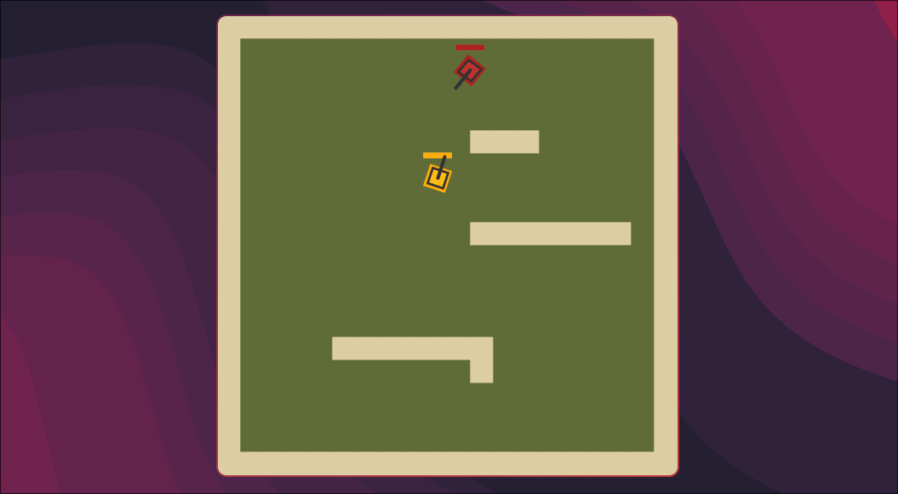

<!-- Improved compatibility of back to top link: See: https://github.com/othneildrew/Best-README-Template/pull/73 -->
<a id="readme-top"></a>

<!-- PROJECT SHIELDS -->

<!--
[![Contributors][contributors-shield]][contributors-url]
[![Forks][forks-shield]][forks-url]
[![Stargazers][stars-shield]][stars-url]
[![Issues][issues-shield]][issues-url]
[![project_license][license-shield]][license-url]
[![LinkedIn][linkedin-shield]][linkedin-url]
-->

<!-- PROJECT LOGO -->
<h1 align="center">Tank Game</h1>
  <p align="center">
    Tank Game is a multiplayer top down shooter game. This project was created using Processing with Java. Orginally developed for a high school dual credit CS course to develop an understanding of networks, OOP principles, and game colision physics.
  </p>
</div>


<!-- TABLE OF CONTENTS -->
<details>
  <summary>Table of Contents</summary>
  <ol>
    <li>
      <a href="#about-the-project">About The Project</a>
      <ul>
        <li><a href="#built-with">Built With</a></li>
      </ul>
    </li>
    <li>
      <a href="#getting-started">Getting Started</a>
      <ul>
        <li><a href="#prerequisites">Prerequisites</a></li>
        <li><a href="#installation">Installation</a></li>
      </ul>
    </li>
    <li><a href="#roadmap">Roadmap</a></li>
    <li><a href="#license">License</a></li>
    <li><a href="#contact">Contact</a></li>
    <li><a href="#contributors">Contributors</a></li>
    <li><a href="#acknowledgments">Acknowledgments</a></li>
  </ol>
</details>


<!-- ABOUT THE PROJECT -->
## About The Project



<p align="right">(<a href="#readme-top">back to top</a>)</p>

### Built With
[![Processing][processing.org]][Processing-url]
[![Java][java.com]][Java-url]
<p align="right">(<a href="#readme-top">back to top</a>)</p>

<!-- GETTING STARTED -->
## Getting Started

The following are insturction to run the project yourself.

### Prerequisites


* Processing: Download the Processing application from [processing.org][Processing-url].

### Installation

1. Clone the repo.
   ```sh
   git clone https://github.com/jharroff/Tank-Game.git
   ```
2. Open Game.pde in Processing.
3. Play the game :)

<p align="right">(<a href="#readme-top">back to top</a>)</p>


<!-- ROADMAP -->
## Roadmap

This project is no longer being maintained and will stay as is, feel free to fork it yourself and do whatever you want.

<p align="right">(<a href="#readme-top">back to top</a>)</p>


<!-- LICENSE -->
## License

Distributed under the Unlicense. See `LICENSE.txt` for more information. 

<p align="right">(<a href="#readme-top">back to top</a>)</p>


<!-- CONTACT -->
## Contact

Joshua Harroff - joshua@jharroff.net

David Goldfuss - david@davidgoldfuss.com

Project Link: [https://github.com/jharroff/Tank-Game](https://github.com/jharroff/Tank-Game)

<p align="right">(<a href="#readme-top">back to top</a>)</p>

## Contributors

<a href="https://github.com/jharroff/Tank-Game/graphs/contributors">
  
</a>

<p align="right">(<a href="#readme-top">back to top</a>)</p>

<!-- Shields.io badges. You can a comprehensive list with many more badges at: https://github.com/inttter/md-badges -->
[Processing.org]: https://img.shields.io/badge/Processing-blue?style=for-the-badge&logo=processingfoundation
[Processing-url]: https://processing.org
[Java.com]: https://img.shields.io/badge/Java-%23ED8B00.svg?logo=openjdk&logoColor=white&style=for-the-badge
[Java-url]: https://java.com
